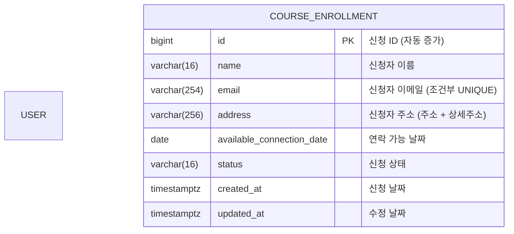

# awesome-school-coding-test

어썸스쿨 사전 과제

## 프로젝트 개요

교육 과정(챗GPT 히어로)을 소개하고 수강 신청을 받는 웹 서비스입니다.

- **랜딩 페이지** (`/`): 교육 소개와 커리큘럼을 보여 줍니다.
- **신청 페이지** (`/register/`): 이름, 이메일, 주소, 연락 가능 날짜를 입력받습니다.
- **신청 API** (`POST /api/course-enrollments`): 신청 내역을 검증하고 저장합니다.
- **관리자 페이지** (`/admin/`): Django Admin으로 신청 내역을 조회하고 처리 상태를 바꿉니다.

```
.
├── server/                    # Django REST Framework (API 서버, Admin)
├── web/                       # 프론트엔드 HTML / CSS / JS (정적 파일)
├── nginx/local.conf           # 로컬 개발 전용 nginx 설정
└── docker-compose.local.yml   # 로컬 개발 전용 (nginx)
```

## 실행 방법

> 별도 표기가 없는 명령은 `server/` 디렉토리에서 실행합니다.

### 요구사항

- Python 3.14 (`server/.python-version` 참고)
- [uv](https://docs.astral.sh/uv/): 패키지와 가상환경 관리
- PostgreSQL 15 이상
- Docker (Docker Compose 포함): 웹 페이지를 확인할 때만 필요합니다.

### 1. 의존성 설치

```bash
cd server
uv sync
```

`.venv/`가 생성되고, `uv.lock`에 고정된 버전으로 설치됩니다.

### 2. 환경 변수 설정

```bash
cp .env.example .env
```

| 변수 | 설명 |
| --- | --- |
| `DJANGO_SECRET_KEY` | Django 시크릿 키 |
| `POSTGRES_DB` / `POSTGRES_USER` / `POSTGRES_PASSWORD` | 데이터베이스 접속 정보 |
| `POSTGRES_HOST` / `POSTGRES_PORT` | 기본값 `localhost` / `5432` |
| `DJANGO_ALLOWED_HOSTS` | 허용할 호스트를 쉼표로 구분합니다 (예: `example.com,www.example.com`). **`dev` / `prod`에서는 필수**이고, `local` / `testing`에서는 사용하지 않습니다. |

시크릿 키는 아래 명령으로 생성할 수 있습니다.

```bash
uv run python -c "from django.core.management.utils import get_random_secret_key; print(get_random_secret_key())"
```

`.env`는 `local` / `testing` 설정에서만 자동으로 읽습니다. `dev` / `prod`는 서버에 설정된 환경 변수를 사용합니다.

### 3. 마이그레이션과 관리자 계정 생성

```bash
uv run python manage.py migrate
uv run python manage.py createsuperuser   # 관리자 페이지 로그인용
```

### 4. API 서버 실행

```bash
uv run python manage.py runserver
```

`manage.py`의 기본 설정이 `config.settings.local`이므로 `--settings`를 생략해도 됩니다.

### 5. 웹 페이지 확인 (로컬 개발 전용)

> ⚠️ `docker-compose.local.yml`과 `nginx/local.conf`는 **로컬 개발 전용**입니다. 실서버(dev / prod) 배포에는 사용하지 않습니다.

`web/`의 HTML 파일을 브라우저에서 직접 열면(`file://`) CSS·JS 경로와 API 호출이 동작하지 않습니다. 그래서 nginx 컨테이너로 운영과 같은 **동일 도메인** 구조를 로컬에 재현합니다.

```
브라우저 → http://localhost:8080 (nginx 컨테이너)
            ├─ /                       → web/
            └─ /api/ /admin/ /static/  → Django runserver (127.0.0.1:8000)
```

4번의 API 서버를 실행한 상태에서, **프로젝트 루트**에서 아래 명령을 실행합니다.

```bash
docker compose -f docker-compose.local.yml up -d     # 실행
docker compose -f docker-compose.local.yml down      # 종료
```

| URL | 내용 |
| --- | --- |
| http://localhost:8080/ | 랜딩 페이지 |
| http://localhost:8080/register/ | 신청 페이지 |
| http://localhost:8080/admin/ | 관리자 페이지 |
| http://localhost:8080/api/docs/ | API 문서 (Swagger UI) |

`web/`은 볼륨으로 연결되어 있어서, 파일을 수정한 뒤 새로고침하면 바로 반영됩니다.

### 6. 테스트

```bash
uv run python manage.py test --settings=config.settings.testing
```

테스트용 데이터베이스는 자동으로 생성되고, 끝나면 삭제됩니다.

### 7. 코드 스타일 검사

```bash
uv run ruff check .         # 검사
uv run ruff check --fix .   # 자동 수정
```

### 설정 환경 (settings)

| 모듈 | 용도 | `.env` 로드 | `DEBUG` | API 문서 | `DJANGO_ALLOWED_HOSTS` |
| --- | --- | --- | --- | --- | --- |
| `config.settings.local` | 로컬 개발 (기본값) | O | O | O | 사용 안 함 (localhost만 허용) |
| `config.settings.testing` | 테스트 | O | O | X | 사용 안 함 |
| `config.settings.dev` | 개발 서버 | X | O | O | **필수** |
| `config.settings.prod` | 운영 서버 | X | X | X | **필수** |

`prod`에서는 Django가 정적 파일을 서빙하지 않습니다. 관리자 페이지의 정적 파일은 `collectstatic`으로 `server/staticfiles/`에 모은 뒤, 별도의 웹 서버나 CDN이 `/static/` 경로로 서빙해야 합니다.

```bash
export DJANGO_ALLOWED_HOSTS=example.com   # 서버에 이미 설정되어 있다면 생략
uv run python manage.py collectstatic --settings=config.settings.prod
```

`prod`는 `.env`를 읽지 않으므로, `DJANGO_ALLOWED_HOSTS`가 환경 변수로 설정되어 있어야 실행됩니다.

## 사용 기술과 사용한 이유

| 기술 | 사용한 이유 |
| --- | --- |
| djangorestframework-camel-case | JS는 camelCase, Python은 snake_case를 그대로 사용 |
| drf-spectacular | API 문서 자동 생성 (local / dev 한정) |
| nginx (개발용, 동일 도메인) | 웹과 API를 같은 도메인에 두어 CORS 설정 불필요 |
| 카카오 우편번호 서비스 | 주소 입력 오류 감소 |
| uv, ruff | 의존성 버전 고정, 코드 스타일 통일 |

## 설계 내용 및 의도 

### DB 설계



#### `COURSE_ENROLLMENT`: 교육 신청 내역

**신청 상태(`status`)를 6단계로 나눈 이유**

신청은 접수로 끝나지 않고, 관리자가 처리하는 과정과 그 이후까지 이어집니다. 그래서 정상 흐름 외의 결과도 상태로 남기도록 했습니다.

| 상태 | 의미 | 둔 이유 |
| --- | --- | --- |
| `PENDING` | 신청 접수 | 신청 직후의 상태. API로 생성하면 항상 이 값으로 저장됩니다 |
| `IN_REVIEW` | 확인중 | 관리자가 접수 내용을 확인하는 단계 |
| `APPROVED` | 접수 완료 | 확인이 끝나 수강 예정인 상태 |
| `REJECT` | 반려 | 관리자가 접수 내용을 보고 정상적인 신청이 아니라고 판단한 경우 |
| `CANCELED` | 취소 | 사용자의 요청(클레임 등)으로 신청을 취소하는 경우 |
| `COMPLETED` | 수강 완료 | 수강을 마친 뒤 **같은 사람이 다시 신청**할 수 있게 하기 위해 |

**중복 신청 방지: 조건부 유니크 제약 (`unique_in_progress_enrollment_per_email`)**

- **목적:** 같은 사람이 악의적으로 신청을 반복하는 경우를 막기 위해서입니다.
- **범위:** 신청이 아직 유효한 동안에만 막습니다.
  - 진행 중인 신청(`PENDING` / `IN_REVIEW` / `APPROVED`)이 있으면 같은 이메일로 다시 신청할 수 없습니다.
  - 이전 신청이 반려·취소·수강 완료로 끝났다면 다시 신청할 수 있습니다.
- **기준을 이름이 아닌 이메일로 둔 이유:** 이름은 동명이인이 있을 수 있지만, 이메일은 보통 한 사람이 고유하게 가지고 있기 때문입니다.
- **DB 제약으로 구현한 이유:** 애플리케이션 코드가 아니라 DB(PostgreSQL partial unique index)가 규칙을 보장합니다. 그래서 API든 관리자 페이지든, 어떤 경로로 저장해도 같은 규칙이 적용됩니다.

**그 외**

- 비회원 신청 구조라 다른 테이블과의 관계(FK)는 두지 않았습니다.
- `address`에는 주소와 상세주소를 공백으로 이어 붙여 하나의 값으로 저장합니다.
  주소는 교재 배송에도 쓰이지만, 배송할 때는 전체 주소 한 줄만 있으면 충분합니다.
  - 상세주소만 따로 조회하거나 지역별로 검색·집계할 계획도 없습니다. 그래서 상세주소를 별도 컬럼으로 나누는 것은 오버스펙이라고 판단했습니다. 

#### `USER`: 관리자 계정

- **별도로 설계하지 않은 이유:** 과제 제약 조건에 사용자 정보를 활용하라는 내용이 없어서, 신청자를 회원으로 관리하지 않았습니다.
- **그래도 모델을 둔 이유:** 신청 내역을 처리할 Django 관리자 페이지가 필요해서, 관리자 계정 용도로 사용합니다.
- **빈 커스텀 모델로 만든 이유:** 나중에 실제 사용자 정보로 확장할 것에 대비했습니다. 필드를 추가하지 않은 커스텀 모델(`AbstractUser` 상속)을 미리 만들어 `AUTH_USER_MODEL`로 지정해 두었습니다. Django는 첫 마이그레이션 이후에 사용자 모델을 교체하기가 어렵기 때문입니다.

### 악의적 신청 방지

* 개요
  * 특정 사용자가 악의적으로 신청을 하는 것을 고려하여 로직을 설계했습니다.
* 구현 내용
  * **같은 사람의 반복 신청 차단 (서버, DB)**
    * 진행 중인 신청이 있는 이메일은 다시 신청할 수 없습니다. 자세한 내용은 위 [DB 설계](#db-설계)의 조건부 유니크 제약을 참고해주세요.
  * **버튼 연타로 인한 중복 요청 차단 (웹)**
    * 신청 요청을 보낸 뒤 응답이 올 때까지 신청 버튼을 비활성화합니다.
    * Enter 키를 연달아 누르는 경우도 별도의 플래그(`isSubmitting`)로 한 번 더 막습니다.
  * **클라이언트가 보낸 값을 그대로 믿지 않음 (서버)**
    * 웹의 입력 검증은 브라우저 개발자 도구나 API 직접 호출로 우회할 수 있습니다. 그래서 최종 검증은 서버가 맡습니다.
    * 신청 상태는 요청에 어떤 값이 들어 있어도 무시하고 항상 `PENDING`으로 저장합니다. 사용자가 `APPROVED` 같은 값을 보내 스스로 승인 처리하는 것을 막기 위해서입니다.
* 한계와 개선 방향
  * **한계:** 프로그램으로 이메일을 바꿔 가며 신청을 반복해서 보내면 막을 수 없습니다. 이메일 소유 여부를 확인하지 않고, 요청 횟수도 제한하지 않기 때문입니다.
  * **요청 횟수 제한:** nginx 같은 프록시 서버를 앞단에 두고 IP별 요청 횟수를 제한합니다.
  * **이메일 인증:** 원래 구현했어야 하는 기능이지만, 시간이 부족해 구현하지 못했습니다. 구현한다면 아래 절차를 따릅니다.
    1. 이메일 입력칸 옆의 "인증 요청" 버튼을 누르면, 서버가 해당 이메일로 랜덤 인증번호를 보냅니다.
    2. 요청이 성공하면 웹에 인증번호 입력칸이 나타나고, 사용자가 입력한 번호를 서버가 확인합니다.
    3. 인증 정보(이메일, 인증번호, 만료 시간)는 DB 테이블에 저장하고, 만료 시간이 지난 인증번호는 사용할 수 없습니다.
    4. 신청 API는 인증을 마친 이메일만 받습니다.

### 교육 정보 데이터 관리

* 개요
  * 교육 소개와 커리큘럼은 DB 대신 `web/js/main.js`의 `landingData` 변수 한곳에서 관리합니다.
* 의도
  * **DB 테이블을 두지 않은 이유:** 요구사항에 교육 정보 목록에 대한 내용이 없어서, 교육 과정은 하나뿐이라고 판단했습니다. 그래서 DB 설계 때 관련 테이블을 만들지 않았습니다.
  * **HTML에 직접 쓰지 않은 이유:** HTML에 직접 적으면, 교육이나 커리큘럼 정보를 바꿀 때마다 HTML 코드에서 해당 위치를 일일이 찾아야 합니다.
  * **그래서 데이터를 한곳에 모았습니다:** 정보를 수정할 때는 `landingData`만 고치면 됩니다. 화면은 JS가 이 데이터로 그립니다.
* 트레이드오프
  * 데이터가 웹 코드 안에 있으므로, 정보를 바꾸면 웹을 다시 배포해야 합니다.

### 기타

- **웹과 API 분리:** `web/`은 Django를 거치지 않는 정적 파일입니다.
  - 과제 제약 조건의 백엔드 프레임워크가 Django가 아니라 DRF로 지정되어 있습니다. DRF는 화면까지 만드는 풀스택 프레임워크가 아니라 API 서버를 만드는 도구입니다. 그래서 화면은 Django 템플릿으로 만들지 않고, 웹을 정적 파일로 분리해 API만 호출하도록 했습니다.
- **입력 검증:**
  - 신청 상태는 클라이언트가 보낸 값과 관계없이 서버가 `PENDING`으로 저장합니다.
  - 연락 가능 날짜는 한국 시간 기준 내일 이후만 받습니다.
- **화면 구성:** 모바일 우선 반응형이고, 태블릿과 PC는 같은 레이아웃을 씁니다.
  * 사용자의 대부분은 PC보다는 모바일을 더 많이 사용하고, 태블릿 레아이웃도 PC에서는 보기에 충분하다고 생각했기 때문입니다.
- **CSS 구성:** CSS는 공통(`style.css`), 컴포넌트(`components.css`), 페이지 CSS 세 계층으로 나누었습니다.


##  AI 사용 범위 요약

### AI 사용 이유
* 시간이 한정되어 있기 때문에 가능한 제시간 안에 코드나 문서를 작성해야 했고, 이 중에 일부를 AI에게 맡겨 구현 속도를 올리는 것이 목적이었습니다.
* 또한, 설계 및 기술적인 측면에서 도움을 얻기 위해 AI를 활용했습니다. AI가 항상 정확한 답변을 제공하는 것은 아니지만, 제가 미처 고려하지 못한 부분이나 대안을 제시해 줌으로써 다양한 관점에서 문제를 검토하고 새로운 방향을 모색할 수 있었습니다.
  * 대표적으로, 중복 신청 방지를 처음에는 Serializer의 `validate()`에서 조회해 막으려고 했습니다. AI와 논의하는 과정에서 PostgreSQL에 특정 조건을 만족하는 행에만 적용되는 조건부 UNIQUE(partial unique index)가 있다는 것을 알게 되었습니다. 이를 Django의 `UniqueConstraint(condition=...)`로 설계에 적용했습니다. 그 결과 "진행 중인 신청끼리만 이메일 중복 불가"라는 규칙을 애플리케이션 코드가 아닌 DB가 보장하게 되었습니다.

### AI에 맡긴 것

* 사용자가 정한 요구사항과 기준에 맞춘 코드 작성
  * 신청 페이지 초안(HTML / JS / CSS)과 CSS 파일 분리
  * 신청 API 테스트 초안, API 문서(drf-spectacular) 설정
  * 로컬 개발용 nginx / docker-compose 구성
  * 버튼 UI (주소 검색, 신청하러 가기)
* 특정 코드 작성 방법과 개념 설명, 대안 비교
* 코드 리뷰성 지적(버그, 누락, 문서 불일치)
* 문서(README, PR 내용) 작성과 문장 다듬기

### 직접 한 것

* 백엔드·프론트 구현
  * 모델, Admin, 중복 신청 제약, 연락 가능 날짜 검증
  * 카카오 우편번호 연동, 상세주소 처리
  * 랜딩 페이지, 환경 설정(ALLOWED_HOSTS 등), 마이그레이션 정리
  * AI가 작성한 코드의 검토와 수정
* 요구사항 해석과 설계 결정 (AI는 선택지와 장단점만 제시하고, 최종 결정은 직접 했습니다)
  * 신청 상태 6단계, 중복 신청 기준을 이메일로 정한 것
  * 중복 신청을 DB 제약으로 막기로 한 것, 교육 정보 테이블을 두지 않은 것
  * 상세주소를 분리하지 않은 것, Admin에서는 날짜 검증을 생략한 것 등
* 설계 의도의 내용 (README의 의도 문장은 직접 정리한 내용을 AI가 다듬은 것입니다)
* 동작 검증(테스트, 브라우저 자동화)
* 커밋, push, 머지와 최종 검토 (PR 등록만 요청에 따라 AI가 수행했습니다)
* DB 구조 변경 같은 되돌리기 어려운 작업